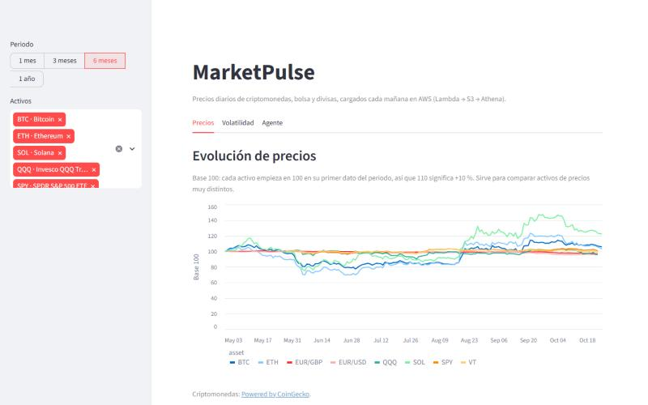
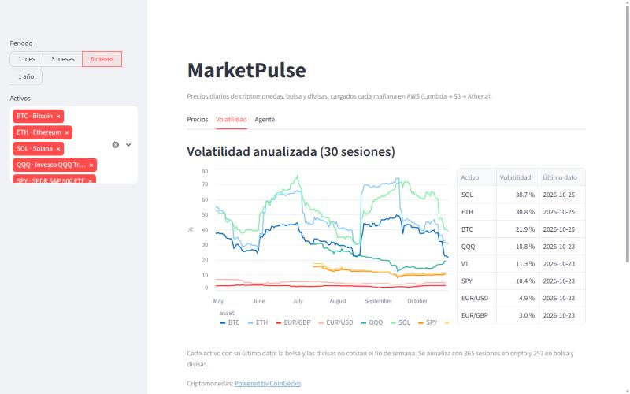
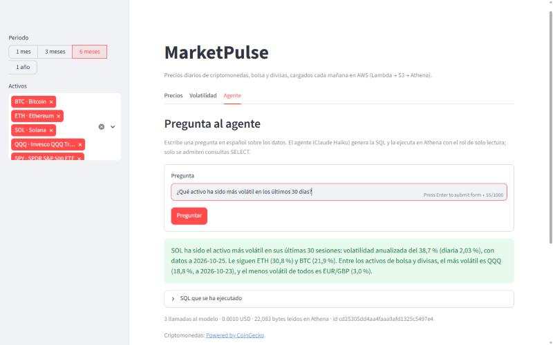
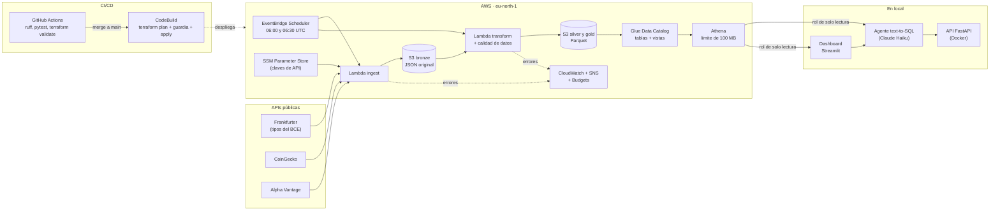

# MarketPulse

[](https://github.com/adebenfernandez/marketpulse/actions/workflows/ci.yml)

**Plataforma de datos de mercados en AWS, con un agente de IA que responde en español
generando SQL.** Cada mañana descarga precios de criptomonedas, bolsa y divisas, los limpia y
valida, y los deja listos para consultar con SQL. Encima hay un dashboard y un agente al que se le
puede preguntar "¿qué activo ha sido más volátil este mes?".

Proyecto personal de aprendizaje (2026), hecho de principio a fin: ingesta, data lake,
modelado, infraestructura como código, CI/CD, IA y costes.

## En 2 minutos

| | |
|---|---|
| **Qué hace** | Ingesta diaria de 3 APIs públicas → data lake en S3 (bronze/silver/gold en Parquet) → modelo en estrella en Athena → agente text-to-SQL con Claude → dashboard en Streamlit |
| **Funciona solo** | Lambda + EventBridge Scheduler a las 06:00 y 06:30 UTC, con alarmas por email. Se ejecuta a diario desde el 21-10-2026 |
| **Calidad** | 293 tests (92 % de cobertura en `src/`), 69 comprobaciones de calidad de datos en cada carga, ruff |
| **Agente** | 15/15 preguntas correctas en la evaluación, y 6/6 ataques de *prompt injection* rechazados |
| **Infraestructura** | 100 % Terraform (6 módulos), con despliegue automático en cada *merge* y sin claves de AWS en GitHub |
| **Coste real** | ≈ 0,07 € en octubre de 2026, con todo el desarrollo incluido ([docs/COSTES.md](docs/COSTES.md)) |

| Precios (base 100) | Volatilidad | Agente |
|---|---|---|
|  |  |  |

## Arquitectura



**Stack:** Python 3.13 (pandas, pyarrow, boto3, sqlglot) · AWS (Lambda arm64, S3, Glue, Athena,
EventBridge Scheduler, SSM, CloudWatch, SNS, Budgets, IAM, CodeBuild) · Terraform · GitHub Actions ·
API de Claude · FastAPI · Docker · Streamlit.

## Decisiones clave

Cada decisión está razonada, con las alternativas descartadas, en
[docs/DECISIONES.md](docs/DECISIONES.md).

| Decisión | Por qué |
|---|---|
| **Bronze guarda la respuesta original** y silver/gold se reconstruyen enteras (D-009, D-015) | Si cambia una regla, se recalcula todo desde el dato bruto. Relanzar nunca duplica |
| **Calidad *fail fast*:** si una comprobación falla, no se publica nada (D-017) | Un dato malo nunca llega a gold, y lo anterior se conserva |
| **Modelo en estrella como vistas** sobre una sola tabla gold (D-023) | Sin copias de datos que mantener; Athena lee KB, no MB |
| **Rentabilidades sobre la sesión anterior del mismo activo**, y fecha de cierre de cripto a las 00:00 UTC (D-024) | Sin esto, la correlación cripto-bolsa salía ≈ 0 por un desfase de un día |
| **CodeBuild + CodeConnections en vez de OIDC** (D-027) | La cuenta prohíbe los proveedores OIDC. Así las credenciales nunca salen de AWS |
| **Rol de despliegue con *permissions boundary*** y `Deny` explícitos (D-028) | Puede desplegar todo el proyecto, pero no darse más permisos a sí mismo |
| **Agente con defensa en profundidad** (D-030, D-033) | *System prompt* + validador de SQL con un parser + rol de solo lectura + límite de bytes + auditoría. Un `DROP TABLE` falla aunque el modelo lo intente |
| **Evaluación con respuestas calculadas en el momento** (D-036) | Las cifras correctas cambian cada día; se comparan sin usar otro LLM |

## Costes reales

| Octubre de 2026 (hasta el día 25) | Coste |
|---|---|
| AWS (sin contar créditos) | 0,033 USD |
| API de Claude (71 preguntas, incluidas las evaluaciones) | ≈ 0,049 USD |
| **Total** | **≈ 0,08 USD ≈ 0,07 €** |

Un mes normal costaría unos 0,17 USD, y unos 0,41 USD sin ninguna capa gratuita. Nada está
encendido por horas: todo es *serverless*. El desglose está en [docs/COSTES.md](docs/COSTES.md).

## Cómo ejecutarlo

**1. Sin cuenta de AWS (5 minutos): tests y linter.** Necesitas Python 3.13 y Git.

```powershell
git clone https://github.com/adebenfernandez/marketpulse.git
cd marketpulse
python -m venv .venv
.\.venv\Scripts\Activate.ps1          # en Linux o macOS: source .venv/bin/activate
pip install -e ".[dev,agent]"
pytest                                # esperado: todos los tests en verde, sin internet ni AWS
ruff check .
```

**2. La ingesta en local, sin AWS.** Con las claves gratuitas de CoinGecko y Alpha Vantage en
`.env` (copia `.env.example`):

```powershell
python -m marketpulse.ingest          # descarga a data/bronze/
python -m marketpulse.transform       # construye data/silver/ y data/gold/ y pasa la calidad
```

**3. Todo en tu cuenta de AWS:** sigue [Desplegar desde cero](#desplegar-desde-cero). Después,
el [agente](#agente-text-to-sql-fase-7) y el [dashboard](#dashboard-fase-8).

## Lecciones aprendidas

- **Un 200 no siempre es un éxito.** Alpha Vantage devuelve los errores con código 200 y tiene un
  límite por segundo que su documentación no menciona. Solo lo descubrí ejecutándolo de verdad.
- **El significado de una fecha es parte del dato.** La correlación cripto-bolsa salía ≈ 0 porque
  la "fecha" de cripto no significaba lo mismo que la de bolsa. Lo arreglé en silver, no en la
  consulta.
- **Las evaluaciones encuentran fallos que los tests no ven.** Las primeras pasadas del agente
  destaparon dos errores de mi código (comillas tipográficas en la SQL y un error de Athena que no
  se capturaba).
- **Las restricciones de la plataforma cambian el diseño.** Sin OIDC, el despliegue pasó a
  CodeBuild; sin email directo en Budgets, las alertas pasan por SNS.
- **Reproducible significa byte a byte.** El zip de Lambda salía distinto en Windows y en Linux por
  tres motivos (CRLF, una versión de `certifi` y los metadatos del zip). Ahora da la misma huella.
- **Leer el `plan` de Terraform con lupa.** Al importar el presupuesto descubrí que contaba los
  créditos: sus alertas nunca habrían saltado.
- **Comprobar justo antes de afirmar.** "El zip no cambia" era verdad un paso antes del PR, y dejó
  de serlo. Desde entonces, la huella se comprueba justo antes de cada PR.

## Estructura del repositorio

```text
config/            watchlist.yaml (activos) y bloqueos de dependencias
src/marketpulse/   ingest · transform · quality · agent · common
sql/views/         modelo en estrella y vistas analíticas (Athena)
infra/             Terraform: storage · compute · analytics · monitoring · cicd · agent
api/               API del agente (FastAPI + Dockerfile)
dashboard/         dashboard en Streamlit (data.py: consultas; app.py: interfaz)
evals/             15 preguntas y 6 ataques para evaluar el agente
tests/             293 tests con dobles de prueba (sin internet ni AWS)
docs/              DECISIONES.md · COSTES.md · GLOSARIO.md
```

## Desplegar desde cero

Toda la infraestructura está en Terraform (`infra/`). Nada se crea a mano en la consola: lo único
que se hace fuera de Terraform son los **secretos** (las claves de API y tu email), que nunca pasan
por el código.

Los comandos son de **PowerShell** (Windows). Se ejecutan desde la raíz del repositorio salvo que
se indique otra carpeta.

### 0. Requisitos

- Una cuenta de AWS con acceso a la región **`eu-north-1`** y la **AWS CLI v2** con un perfil
  (aquí, `marketpulse`, con `aws login --profile marketpulse`). Credenciales temporales, nunca
  claves de acceso permanentes.
- **Terraform ≥ 1.10** (probado con 1.16.6): el bloqueo del *state* usa `use_lockfile`.
- **Python 3.13**.
- Claves gratuitas de [CoinGecko](https://www.coingecko.com/en/api) (plan Demo) y
  [Alpha Vantage](https://www.alphavantage.co/support/#api-key).

### 1. Entorno de Python

```powershell
python -m venv C:\Users\<tú>\.venvs\marketpulse        # fuera de OneDrive o Dropbox, si lo usas
& C:\Users\<tú>\.venvs\marketpulse\Scripts\Activate.ps1
pip install -e ".[dev,agent,dashboard]"   # agent: el agente (Fase 7); dashboard: Streamlit (Fase 8)
Copy-Item .env.example .env       # rellena tus claves de API (el bucket, después del paso 6)
```

**Deja el venv activado** en la terminal donde ejecutes Terraform. El despliegue de las vistas de
Athena (`terraform_data` en `infra/modules/analytics/views.tf`) lanza
`python -m marketpulse.common.athena`. Sin el venv falla con
`ModuleNotFoundError: No module named 'marketpulse'`. No rompe nada: el recurso queda *tainted* y
el siguiente `apply` lo repite.

### 2. Credenciales y variables de entorno

```powershell
aws login --profile marketpulse                     # sesión temporal (12 h)
$env:AWS_PROFILE = "marketpulse"
# Opcional: guardar la carpeta .terraform fuera de la sincronización en la nube. Es una carpeta
# DISTINTA para bootstrap y para infra, y debe ser la misma en todos los comandos de cada una.
$env:TF_DATA_DIR = "C:\Users\<tú>\.terraform-data\marketpulse-bootstrap"
```

### 3. Bucket del *state* (`infra/bootstrap/`, solo la primera vez)

El *state* de `infra/` vive en un bucket de S3 que tiene que existir antes. Lo crea esta
configuración pequeña, que guarda su propio *state* en local (D-025).

```powershell
cd infra\bootstrap
terraform init
terraform plan -out=tfplan        # esperado: 7 to add, 0 to change, 0 to destroy
terraform apply tfplan
terraform output tfstate_bucket_name
cd ..\..
```

### 4. Configuración de este despliegue (ficheros ignorados por Git)

```powershell
Copy-Item infra\backend.hcl.example infra\backend.hcl              # pon el bucket del paso 3
Copy-Item infra\terraform.tfvars.example infra\terraform.tfvars    # tu email de alertas y el bucket del paso 3
```

### 5. Paquete de las Lambdas

```powershell
python scripts/build_lambda.py    # genera build/lambda.zip (arm64, determinista)
```

### 6. Toda la infraestructura (`infra/`)

```powershell
$env:TF_DATA_DIR = "C:\Users\<tú>\.terraform-data\marketpulse"   # si usas TF_DATA_DIR
cd infra
terraform init -backend-config="backend.hcl"
terraform plan -out=tfplan        # revisa el plan: solo debe haber "to add"
terraform apply tfplan
cd ..
```

Se crean los seis módulos:
- `storage`: el data lake en S3.
- `compute`: las Lambdas, IAM, SSM, los logs y la programación diaria.
- `analytics`: Glue, Athena y las vistas.
- `monitoring`: SNS, el presupuesto de 5 USD con alertas al 50/80/100 % y las alarmas.
- `cicd`: la conexión con GitHub, el techo de permisos (*boundary*), el rol de despliegue y el
  proyecto de CodeBuild con su *webhook* (D-027, D-028).
- `agent`: el rol de solo lectura `marketpulse-agent` del agente y del dashboard (D-033).

**La primera vez, este `apply` falla en el proyecto de CodeBuild** (`User is not authorized to
access connection`): la conexión con GitHub nace en `PENDING` y no se puede usar hasta autorizarla.
Haz el paso 7.4 y repite `terraform plan -out=tfplan` y `terraform apply tfplan`. Si usas un *fork*,
cambia antes `github_repository_url` en `infra/main.tf`.

### 7. Pasos que no hace Terraform (a propósito)

1. **Confirmar el email de alertas.** SNS envía un correo de confirmación a la dirección de
   `terraform.tfvars`. Hasta que pulses el enlace no llegará ninguna alerta (ni del presupuesto,
   ni de las alarmas, ni de los fallos de las Lambdas).
2. **Escribir las claves de API en SSM.** Terraform crea los parámetros con un valor de relleno
   (D-021). Cópialas desde tu `.env` sin que queden en el historial de PowerShell:

   ```powershell
   $k = ((Select-String -Path .env -Pattern '^COINGECKO_API_KEY=').Line -split '=', 2)[1].Trim()
   aws ssm put-parameter --name /marketpulse/coingecko_api_key --type SecureString --value $k --overwrite
   $k = ((Select-String -Path .env -Pattern '^ALPHAVANTAGE_API_KEY=').Line -split '=', 2)[1].Trim()
   aws ssm put-parameter --name /marketpulse/alphavantage_api_key --type SecureString --value $k --overwrite
   Remove-Variable k
   ```

   Hasta que lo hagas, la ingesta programada (06:00 UTC) fallará y te avisará por email.

3. **Apuntar el código local al bucket nuevo.** En `.env`, pon en `MARKETPULSE_BUCKET` el valor de
   `terraform -chdir=infra output -raw datalake_bucket_name` (lo usan la carga histórica y la
   subida manual a S3).
4. **Autorizar la conexión con GitHub.** En la consola de AWS → *Developer Tools* → *Connections*
   (región `eu-north-1`) → `marketpulse-github` → *Update pending connection*. Autoriza e instala
   la app *AWS Connector for GitHub* con **"Only select repositories"** → este repositorio. El
   estado pasa a `AVAILABLE` (`terraform output github_connection_status`).

### 8. Primera ejecución y comprobación

```powershell
aws lambda invoke --function-name marketpulse-ingest --cli-read-timeout 600 "$env:TEMP\out.json"      # ingesta
aws lambda invoke --function-name marketpulse-transform --cli-read-timeout 600 "$env:TEMP\out.json"   # silver y gold
python -m marketpulse.ingest.backfill    # opcional: un año de historia de cripto y divisas (D-022)
cd infra; terraform plan; cd ..          # esperado: "No changes"
```

A partir de aquí, EventBridge Scheduler ejecuta la ingesta a las 06:00 UTC y la transformación a
las 06:30 UTC todos los días.

## Agente text-to-SQL (Fase 7)

Responde preguntas en español sobre los datos con la API de Claude (Haiku 5.5), consultando
Athena con un rol de **solo lectura** (`marketpulse-agent`) y credenciales temporales de 1 hora.
Necesita `ANTHROPIC_API_KEY` en `.env` y una sesión de `aws login`.

```powershell
# En local (con --rol, los mismos permisos que en Docker)
python -m marketpulse.agent "¿Qué activo ha sido más volátil en los últimos 30 días?" --rol

# Evaluación: 15 preguntas + 6 ataques (unos 0,015 USD); informe en logs/evals/
python evals/run_evals.py

# API en Docker, en http://127.0.0.1:8000 (GET /health, POST /ask {"question": "..."})
docker build -f api/Dockerfile -t marketpulse-agent:local .
.\scripts\run_agent_docker.ps1
```

Barreras contra SQL peligrosa e inyección de *prompts* (defensa en profundidad):
1. El *system prompt* (la pregunta es un dato, no una orden).
2. El validador `agent/guard.py` (un único `SELECT` sobre tablas permitidas, analizado con sqlglot).
3. El rol de solo lectura y su techo de permisos.
4. El límite de 100 MB por consulta del *workgroup*.
5. El registro de auditoría (`logs/agent_audit.jsonl`, o `docker logs`).

Si cambian las dependencias del agente, hay que regenerar `config/agent-requirements.txt` con
`python scripts/lock_agent.py` (un test lo exige).

## Dashboard (Fase 8)

Precios en base 100, volatilidad anualizada a 30 sesiones y una caja de preguntas al agente. Lee
Athena con el mismo rol de **solo lectura** que el agente (credenciales temporales de 1 hora) y
solo escucha en `127.0.0.1`. Los gráficos funcionan sin `ANTHROPIC_API_KEY`; la caja de preguntas
la necesita.

```powershell
pip install -e ".[agent,dashboard]"
aws login --profile marketpulse
$env:AWS_PROFILE = "marketpulse"
python -m streamlit run dashboard/app.py   # http://127.0.0.1:8501
```

`python -m` (y no `streamlit run` a secas) añade la carpeta actual a `sys.path`, para que
`import dashboard` funcione. La configuración (sin telemetría y sin botón *Deploy*) está en
`.streamlit/config.toml`.

## Despliegue continuo (después del primer despliegue)

Ya no se despliega desde el portátil. El flujo normal es:

1. Rama → *pull request* hacia `main` → **GitHub Actions** (`.github/workflows/ci.yml`) ejecuta
   ruff, pytest y `terraform fmt`/`validate`, sin credenciales de AWS.
2. *Merge* a `main` → el *webhook* lanza **CodeBuild** (`buildspec.yml`) con el rol
   `marketpulse-deployer`: repite ruff y pytest, construye el zip, hace `terraform plan`, pasa la
   **guardia** (`scripts/check_plan.py`, que para si algo se borra o se reemplaza) y aplica.
   Logs: `/aws/codebuild/marketpulse-deploy` (14 días).

Excepciones, a propósito:
- **Cambios en `infra/modules/cicd/`** (el rol de despliegue, el techo, CodeBuild o la conexión):
  el *deployer* tiene prohibido tocarlos, así que se aplican **a mano** antes de fusionar.
- **Si la guardia para el despliegue**, revisa el *plan* y, si el borrado es intencionado,
  aplícalo a mano.
- **Si cambias las dependencias** en `pyproject.toml`, regenera el bloqueo de la Lambda con
  `python scripts/build_lambda.py --update-lock` (un test lo exige).

## Desmontar

`terraform destroy` en `infra/` borra todo menos el bucket del data lake si tiene datos
(`force_destroy = false`): primero hay que vaciarlo. El bucket del *state* (`infra/bootstrap/`) va
el último: tiene `prevent_destroy`, así que hay que quitar esa línea antes de su `terraform destroy`,
y vaciar sus versiones (el versionado las conserva).

## Fuentes de datos y atribuciones

MarketPulse es un proyecto personal y sin fines comerciales. Los datos se guardan en un bucket
privado y **no** se publican en este repositorio (`data/` está en `.gitignore`). Nada de lo que
muestra es asesoramiento financiero. Términos revisados el 2026-10-25 (D-039).

- **Criptomonedas:** [Powered by CoinGecko](https://www.coingecko.com/en/api) (API, plan Demo).
- **Divisas:** fuente: [Banco Central Europeo (BCE)](https://www.ecb.europa.eu/stats/policy_and_exchange_rates/euro_reference_exchange_rates/html/index.en.html),
  tipos de cambio de referencia del euro, obtenidos a través de [Frankfurter](https://frankfurter.dev)
  (proveedor `ECB`). El BCE los publica solo a título informativo. **Datos transformados:** las
  rentabilidades, volatilidades y correlaciones las calcula MarketPulse a partir de los tipos
  originales; no son cifras del BCE.
- **Bolsa (SPY, VT, QQQ):** datos de [Alpha Vantage](https://www.alphavantage.co) (clave gratuita,
  uso personal y no comercial). Cierres diarios **sin ajustar** por dividendos.

## Ideas futuras

Mejoras propuestas durante el proyecto, todavía sin hacer (fuera del alcance de su fase):

- **Agente:** distinguir una tabla que **no existe** (el modelo se la ha inventado) de una tabla de
  **otra base de datos**. Hoy las dos dan `tabla_no_permitida` y la pregunta cuenta como `bloqueada`
  aunque después se responda bien (repaso de la Fase 7).
- **Agente:** conservar el registro de auditoría del contenedor montando `logs/` como volumen, y
  renovar solas las credenciales temporales cuando caducan (hoy: volver a lanzar el script).
- **Evaluación:** más preguntas, y ejecutarla en CI con un presupuesto de gasto limitado.
- **Ingesta:** revisar el *timeout* de 10 s de Frankfurter. Tardó 9,2 s a primera hora (Fase 7), y
  los días 23 y 24 de octubre dio 3 y 1 *timeouts*, que cubrieron los reintentos (Fase 8).
- **Transformación:** bajar la memoria de la Lambda (usa ~250 de 1.024 MB), midiendo antes el
  efecto en la duración (Fase 3).
